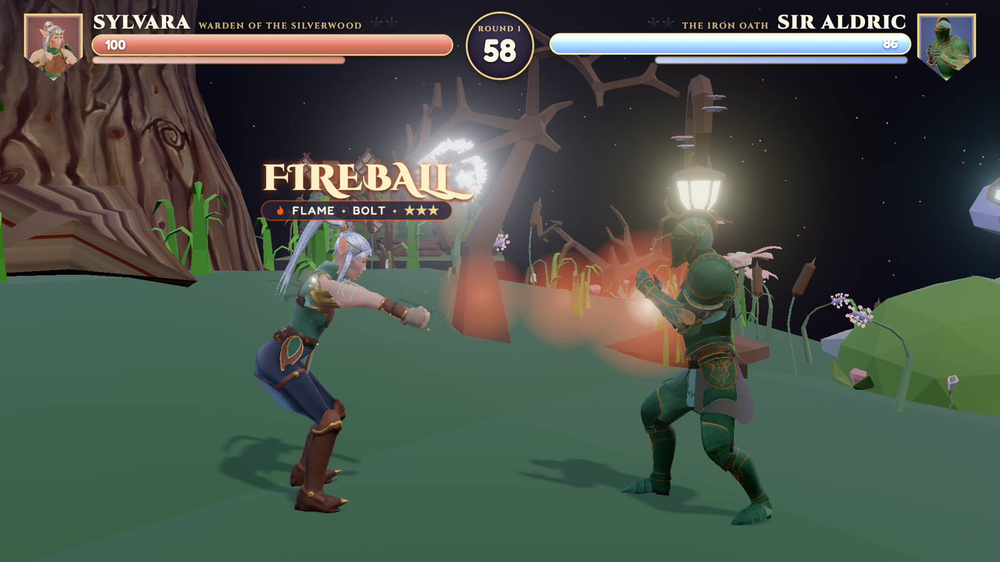
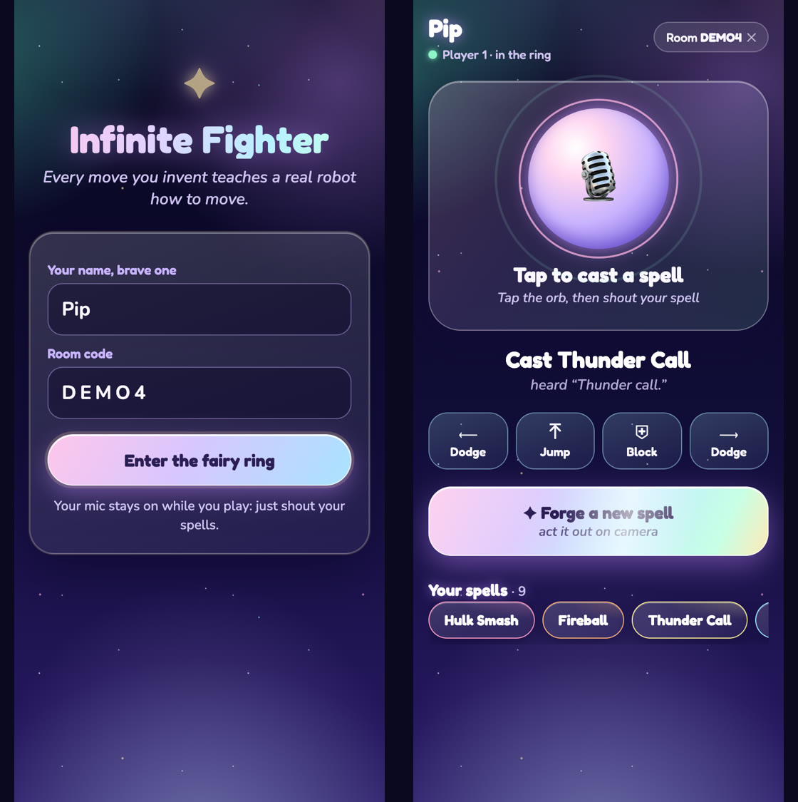
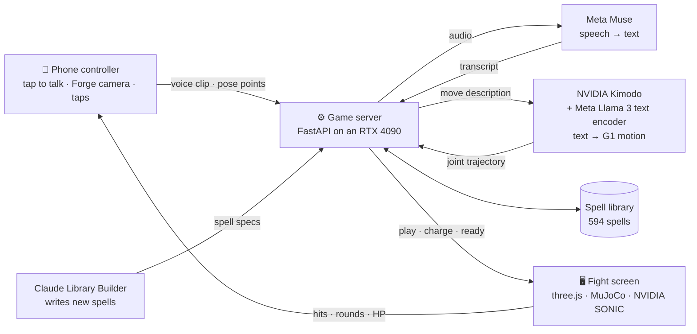
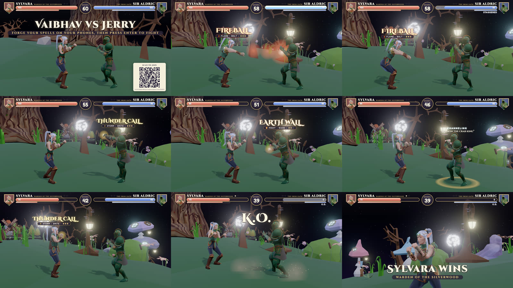

<div align="center">

# 🥊 RoboRumble

### Your imagination is the controller.

**Shout any move, or act one out on your phone, and a humanoid robot fights with it, seconds later.**




</div>

---

## The idea

When we were younger, the best fights were the ones with action figures: you smashed them together and
yelled **"Fireball!"** or **"Sonic Boom!"**, and in your head they did it. Fighting games took that away:
every move you can ever make is stuck on a controller with **about a dozen buttons**, picked by someone
else before you ever pressed one.

**RoboRumble removes the buttons.** There is no move list. Say a move, even one nobody has ever thought
of, or act it out in front of your phone, and a **Unitree G1 humanoid** performs it in a physics-simulated
fairy-tale arena.

## At a glance

| | |
| ---: | --- |
| **0.8 s** | to generate a brand-new full-body robot motion (NVIDIA Kimodo on one RTX 4090; 0.5 to 0.95 s measured) |
| **~2 s** | from the end of a shout to the robot moving |
| **< 0.5 s** | to cast a spell by tapping it |
| **594** | spells in the library: 565 from our Claude-powered Library Builder, 25 forged by players, 4 shouted into existence |
| **812 → 372** | Kimodo motions tested in MuJoCo physics with NVIDIA's SONIC controller → kept |
| **33** | body points the phone tracks in the Forge; no video ever leaves the phone |
| **29** | joints in every move, 30 frames a second, real Unitree G1 joint data |
| **3 · 24 h · 140+** | people, hours, commits (about 47,000 lines of code) |

## How it plays



1. **Join.** The big screen shows a QR code. Scan it and your phone becomes the controller. It's a
   website, so there's no app to install.
2. **Shout a move.** Tap the mic orb and shout. "Fireball" casts in about two seconds. Something brand
   new, like *"summon the crab king"*, is generated live while your robot charges up, then joins the
   library with your name on it.
3. **Forge your own.** Act a move out for 4 seconds in front of your phone. It tracks your body, replays
   what it caught, and the robot learns *your* version of the move.
4. **Fight.** Moves land with real physics: a punch only hits if the fist actually connects, and a
   knockout is a real fall. Dodge, jump and block with the buttons on your phone.

Tap any spell on your phone for an instant cast. Every move you invent stays in the library with your
name on it.

<br clear="right">

## How it works



### Every technology, and where you see it in the game

| When you… | What's running |
| --- | --- |
| **scan the QR code** | a plain web page talking to our **FastAPI** server over **WebSockets**: your phone joins the room |
| **shout "Fireball!"** | **Meta Muse Voice Transcribe** turns the shout into words in about a second, and an **all-MiniLM-L6-v2** matcher finds the spell, even when it's misheard ("Resengan" still casts Rasengan) |
| **shout something that's never existed** | **Meta Llama 3** (inside Kimodo) understands the move, and **NVIDIA Kimodo** generates a brand-new full-body **Unitree G1** motion in about 0.8 s, while the server checks it for drift, floor contact and joint limits |
| **act a move out in the Forge** | **MediaPipe Pose** tracks 33 points on your body on the phone, the server fits a G1 to your poses (**MuJoCo** kinematics + **SciPy**), and Kimodo uses them as keyframes |
| **land a hit, dodge, get knocked down** | **MuJoCo** physics in the browser, with **NVIDIA's SONIC** whole-body controller (via **onnxruntime-web**) keeping each robot balanced |
| **watch the fight** | a **three.js** fight screen built with **Vite**: night forest arena, spell effects, characters made in **Blender** |
| **see a brand-new library spell** | a **Claude** agent that writes, validates and dedupes spell specs and sends them to Kimodo in batches |

## Results

- **A library built in minutes.** In one 15-minute run, the Claude Library Builder wrote **250** spells;
  **203** passed validation and Kimodo's quality checks, and Kimodo rejected only **2** for barely moving.
- **Physics-checked motion.** Sudeep's pipeline generated **812** candidate motions for **33** everyday
  moves (guards, steps, dodges, blocks, punches, get-ups), ran each one in MuJoCo with SONIC against real
  punches, and kept the **372** that held up ([report](passive/public/clips-everyday/report.md)).
- **Voice, tested end to end.** In our test (real phone page, a tap, spoken audio,
  Muse, a live fight screen), **4 of 4** shouts cast the right spell.
- **The whole loop runs live.** Shout to robot in about 2 seconds; older AI motion models took **15 to
  30 seconds** for one animation.

<div align="center">

<br><sub>One full match, left to right: the lobby, Fireball, Thunder Call, Earth Wall, "summon the crab king", K.O., and the winner.</sub>
</div>

**Watch the spells:** [Fireball](docs/kimodo-spells/fireball.mp4) ·
[Thunder Call](docs/kimodo-spells/thunder_call.mp4) · [Earth Wall](docs/kimodo-spells/earth_wall.mp4) ·
[Spiral Sphere](docs/kimodo-spells/spiral_sphere.mp4)

## Repo

| Folder | What | Who |
| --- | --- | --- |
| [`passive/`](passive/) | **The game:** the fight screen (MuJoCo physics, SONIC, night forest arena, HUD, rounds, phones) and the simulator rig | Sudeep |
| [`server/`](server/) | Game server: Kimodo jobs, quality checks, spell library, voice, matching, Forge, rooms | Vaibhav |
| [`phone/`](phone/) | The phone controller website, served by the server at `/phone` | Vaibhav |
| [`agent/`](agent/) | The Claude Library Builder | Jerry |
| [`client/`](client/) | The first game screen (three.js, stub sim), kept for testing | Jerry |
| [`characters/`](characters/) | Character skins drawn over the G1 | Sudeep |
| [`contract/`](contract/) | The HTTP API and WebSocket messages between the parts | everyone |
| [`data/`](data/) | A snapshot of the spell library: 594 spells and their motions | |
| [`docs/`](docs/) | Kimodo notes, physics notes, GPU setup, spell videos | |

## Run it

```bash
# 1. The game server. Any laptop works with the mock engine: every library spell plays its real motion.
LIBRARY_DIR=data/library-snapshot ./server/run.sh                 # http://localhost:8000
LIBRARY_DIR=data/library-snapshot ENGINE=kimodo ./server/run.sh   # on a GPU box: new spells and the Forge too
                                                                  # (server/setup_pod.sh installs Kimodo)

# 2. The fight screen (one-time setup: passive/README.md)
cd passive && npm install && npm run setup && npm run dev
# open http://localhost:5180/?room=DEMO&server=http://localhost:8000 in Chrome
#   &fill=ai  lets one phone fight the AI      &script  plays the pitch video's fixed round

# 3. Phones: scan the QR code on the fight screen (or open <server>/phone/?room=DEMO).
#    Phones need HTTPS for the mic and camera; a tunnel like `cloudflared tunnel --url http://localhost:8000` works.
```

Copy `data/library-snapshot` first if you want to keep it clean: the server writes new spells into
`LIBRARY_DIR`. API keys (Muse, Anthropic) are read from the environment and never stored in the repo.

## Credits

[NVIDIA Kimodo](https://research.nvidia.com/labs/sil/projects/kimodo/) (text-to-motion) ·
NVIDIA GR00T SONIC whole-body controller · [Meta Muse Voice Transcribe](https://ai.meta.com/) ·
Meta Llama 3 8B (Kimodo's text encoder) · [Anthropic Claude](https://www.anthropic.com/) ·
[MuJoCo](https://mujoco.org/) and the [MuJoCo Menagerie](https://github.com/google-deepmind/mujoco_menagerie)
Unitree G1 model · [MediaPipe](https://ai.google.dev/edge/mediapipe) · [three.js](https://threejs.org/)
